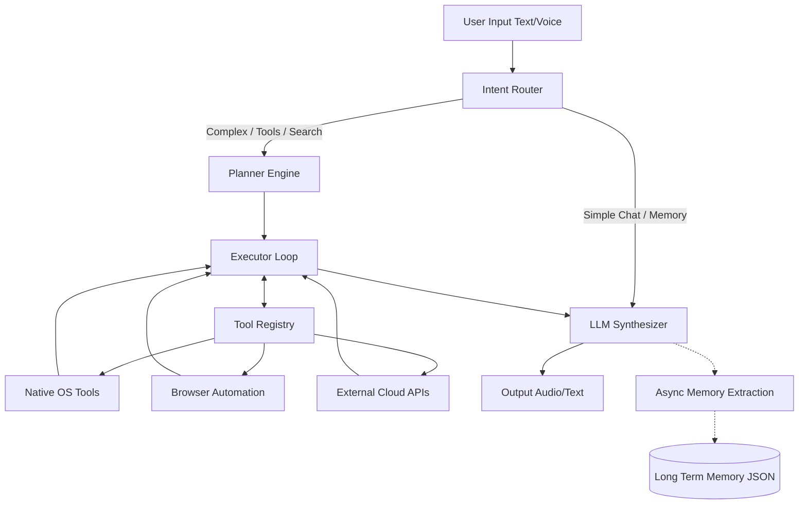
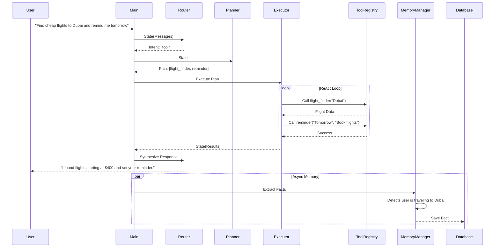
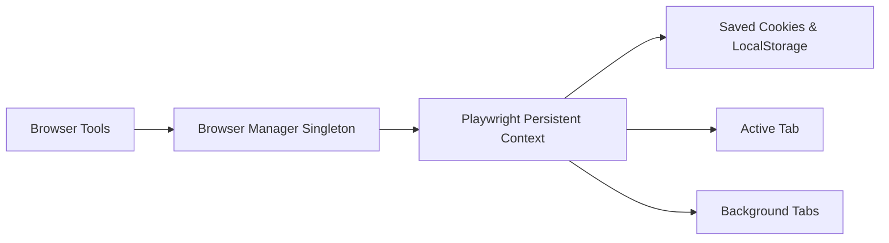
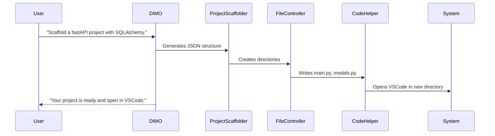
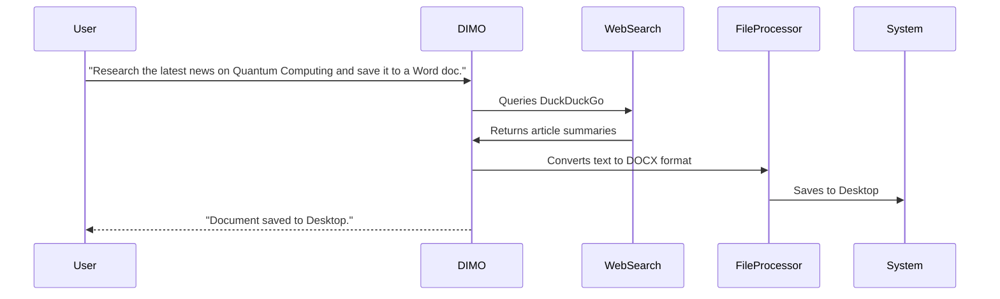

<div align="center">

# DIMO 🧠🤖
**Digital Intelligence for Multimodal Operations**

*A local-first, multimodal, autonomous AI agent capable of completely operating your digital life.*

[](https://www.python.org/)
[](LICENSE)
[]()
[]()
[]()

</div>

---

## 2. Project Overview

**DIMO (Digital Intelligence for Multimodal Operations)** is a fully autonomous, local-first AI system designed to act as an advanced digital assistant. Rather than just returning text, DIMO operates your machine natively. It can read your screen, control your mouse and keyboard, manage your web browser, manipulate files, write code, update your video games, and remember your personal preferences forever.

**Why it exists:**  
Most AI assistants live inside a sandboxed chat window. DIMO is built to break out of the browser and act natively on your operating system, providing a real "Jarvis-like" experience that integrates deeply into Windows.

**Problems it solves:**  
- Context switching between apps.
- Manual execution of repetitive tasks.
- Short-term memory limits in standard LLM chats.
- Separation of code generation and code execution.

**Core Philosophy:**  
Local-first and private by default. DIMO relies heavily on local LLMs (Llama 3 via Ollama) to keep reasoning on your device, with highly secure, targeted cloud API usage for specific heavy-lifting tasks (like fast memory extraction via Gemini Flash Lite).

---

## 3. Key Features

| Feature | Description | Status | Underlying Modules |
|---------|-------------|--------|--------------------|
| **AI Agent** | Core autonomous reasoning engine | ✅ Active | LangGraph, Ollama |
| **Planning Engine** | Breaks down complex multi-step goals | ✅ Active | `app.nodes.planning` |
| **Tool Calling** | Native tool execution with 45+ endpoints | ✅ Active | `app.tools.registry` |
| **Browser Automation** | Headless/Headed persistent web control | ✅ Active | Playwright, `BrowserManager` |
| **Memory System** | Indefinite personal fact retention | ✅ Active | `app.memory.memory_manager` |
| **File Processing** | OCR, PDFs, CSVs, Archives, Audio, Video | ✅ Active | `app.tools.native.file_processor` |
| **Vision Processing** | Screen & webcam analysis | ✅ Active | `app.tools.native.vision` |
| **Messaging** | WhatsApp, Telegram, Instagram DM | ✅ Active | PyAutoGUI, Playwright |
| **Weather** | Live weather reporting | ✅ Active | `app.tools.native.weather` |
| **Flight Search** | Google Flights automation | ✅ Active | `app.tools.native.flights` |
| **YouTube Integration**| Play, summarize, and query trending videos | ✅ Active | `app.tools.native.youtube` |
| **Reminder System** | Windows Task Scheduler integration | ✅ Active | `app.tools.native.reminder` |
| **System Automation** | Mouse, keyboard, volume, brightness | ✅ Active | `app.tools.native.system` |
| **App Control** | Open any app, manage windows | ✅ Active | `app.system.apps` |
| **Code Generation** | Write, explain, run, and debug scripts | ✅ Active | `app.tools.native.dev` |
| **Project Scaffolding**| Build full multi-file architectures | ✅ Active | `app.tools.native.dev` |
| **Voice Features** | Voice Activity Detection, STT, TTS | ✅ Active | Faster-Whisper, Piper TTS |
| **Hybrid AI Arch.** | Mix of fast local routers and cloud APIs | ✅ Active | `LLMGateway` |

---

## 4. Architecture Overview

DIMO utilizes a **Graph-based State Machine** architecture powered by LangGraph. 

1. **User Request**: The user speaks or types a command.
2. **Router**: A fast, local LLM (Llama 3.2 3B) categorizes the intent (e.g., Simple Chat vs. Tool Use).
3. **Planner**: For complex tasks, the reasoning engine (Llama 3 8B) plans a sequence of required tools.
4. **Executor (Loop)**: A ReAct execution loop iteratively invokes tools, observes the output, and feeds it back into the state.
5. **Tool Registry**: Maps semantic intents to one of the 45+ native Python or Browser control tools.
6. **Services & External Systems**: Tools interact with the Windows OS (PyAutoGUI, OS modules), the Web (Playwright), or Cloud APIs (Gemini, Weather).
7. **Synthesizer**: The final state is passed back to the LLM to generate a natural language response.
8. **Memory Manager (Async)**: Concurrently, a fast LLM evaluates the conversation for durable facts and saves them to long-term storage.

---

## 5. High-Level System Flowchart



---

## 6. Complete Request Lifecycle



---

## 7. Tech Stack

| Category | Technologies Used |
|----------|-------------------|
| **Backend Core** | Python 3.10+ |
| **Orchestration** | LangGraph, LangChain |
| **AI (Local)** | Ollama, Llama 3 (8B), Llama 3.2 (3B) |
| **AI (Cloud)** | Google Gemini 2.0 Flash Lite (Memory/Vision) |
| **Voice & Audio** | Faster-Whisper (STT), Piper (TTS), PyAudio |
| **Automation** | PyAutoGUI, Windows OS APIs |
| **Browser Engine**| Playwright (Persistent Contexts) |
| **Memory Db** | Local JSON (`long_term.json`), Qdrant (planned) |

---

## 8. Repository Structure

```text
DIMO/
├── app/
│   ├── browser/          # Playwright singletons, Whatsapp/YouTube/Tabs controllers
│   ├── config/           # Logging, environment, and model verification
│   ├── graph/            # LangGraph state machine definitions (graph.py, state.py)
│   ├── memory/           # Persistent long-term memory extraction and storage
│   ├── nodes/            # Graph execution nodes (planner, router, executor loop)
│   ├── runtime/          # Session tracking and threading contexts
│   ├── services/         # Agents (LLM Gateway) and system utilities
│   ├── system/           # Native Windows application launching scripts
│   └── tools/
│       ├── native/       # Native implementations: files, dev, vision, weather, flights
│       └── registry.py   # Central catalog of all 45+ tools accessible to Planner
├── main.py               # Application entrypoint (CLI & Voice paths)
├── requirements.txt      # Python dependencies
└── .env                  # Environment variables
```

**Folder Responsibilities:**
- `app/graph/`: Contains the state definitions that flow through the LangGraph engine.
- `app/nodes/`: The distinct stages of thinking (routing -> planning -> executing).
- `app/tools/`: The heavy lifters. Each tool here maps to a specific capability.
- `app/browser/`: The Playwright subsystem designed to bypass bot-detection and persist logins.

---

## 9. Core Components

* **Planner (`app.nodes.planning`)**: Analyzes the user's intent and the available tools, outputting a strict JSON plan of tool sequences to run.
* **Executor Loop (`app.nodes.loop`)**: Executes the tools defined by the planner. It handles timeouts, catches exceptions natively, and feeds outputs back into the context window.
* **Memory Manager (`app.memory.memory_manager`)**: Uses an async, two-stage LLM gate to silently observe conversations and extract durable facts (hobbies, names, projects) into long-term storage.
* **Tool Registry (`app.tools.registry`)**: Exposes highly-detailed OpenAPI-style JSON schemas to the LLM so it perfectly understands the required parameters for actions like sending WhatsApp messages or compiling code.
* **Browser Manager (`app.browser.browser_manager`)**: A singleton Playwright instance. It uses stealth tactics to prevent bot detection and persists cookies so you never have to log into WhatsApp or YouTube twice.
* **LLM Gateway (`app.services.agents.llm_gateway`)**: The unified interface handling failovers and routing between Ollama and Gemini APIs.

---

## 10. AI Architecture

DIMO uses a **Hybrid AI Strategy**:
- **Ollama (Llama 3 8B & 3.2 3B)**: Handles the vast majority of operations, including planning, tool parameter extraction, routing, and conversation synthesis. This ensures privacy and zero cost.
- **Gemini 2.0 Flash Lite**: Used specifically for background tasks requiring extremely fast, cheap reasoning, such as the two-stage Memory Extraction gating system.
- **Gemini Vision**: Used by the `screen_process` tool to analyze screen captures.

**Privacy & Cost Optimization:**
By running locally via Ollama, user queries, code generation, and standard operations never leave the local machine. Cloud APIs are reserved for high-bandwidth tasks (Vision) or parallel micro-tasks (Memory).

---

## 11. Tool Ecosystem

*Extracted directly from the `TOOL_CATALOG` in `app/tools/registry.py`*

| Tool | Purpose | Category |
|------|---------|----------|
| `web_search` | Headless DuckDuckGo search for real-time information | Information |
| `open_app` | Launches Windows executables and system apps | System |
| `weather_report` | Fetches live weather for a specific city | Information |
| `compose_message`| Generates text for emails, WhatsApp, apologies, etc. | Utility |
| `send_whatsapp_desktop` | Natively controls WhatsApp desktop to send messages | Messaging |
| `send_telegram_message` | Natively controls Telegram desktop | Messaging |
| `send_instagram_dm` | Automates Instagram DMs via Browser | Messaging |
| `reminder` | Sets Windows Task Scheduler alarms | System |
| `youtube_video` | Plays, summarizes, and fetches YouTube trends | Browser / Info |
| `screen_process` | Captures screen/webcam and performs VQA | Vision |
| `computer_settings` | Changes volume, brightness, dark mode, power state | System |
| `browser_control` | Generic web automation (click, type, scroll) | Browser |
| `file_controller` | Manage local disk (create, delete, move files) | Files |
| `code_helper` | Write, explain, edit, and run code files | Developer |
| `dev_agent` | Scaffolds and builds complete multi-file projects | Developer |
| `project_scaffolder`| Plans JSON project structures and creates directories | Developer |
| `computer_control`| Raw mouse/keyboard macros | System |
| `game_updater` | Manages Steam/Epic Games (install, update) | Gaming |
| `flight_finder` | Scrapes Google Flights for airfare data | Information |
| `file_processor` | Advanced manipulation (PDF, OCR, CSV, Audio, Video) | Files |
| `save_memory` | Async tool to save personal user facts | State |
| `shutdown_dimo` | Gracefully closes the system | State |

*(Note: Browser tools dynamically inject dozens of granular tools like `switch_to_tab`, `get_page_links`, `ask_chatgpt`, etc.)*

---

## 12. Browser Automation System

DIMO treats the browser as a persistent operating environment.

**How it works:**
1. **Singleton Context**: `BrowserManager` launches a single instance of Chromium using a persistent `user_data_dir`.
2. **Stealth**: Overrides `navigator.webdriver` and disables automation info-bars to bypass basic anti-bot scripts.
3. **Authentication**: You log in manually once (e.g., WhatsApp Web). Forever after, DIMO can send messages silently in the background using those saved cookies.
4. **Tab Management**: Tools like `new_tab_url`, `switch_to_tab`, and `close_current_tab` give the LLM spatial awareness of the browser.



---

## 13. Memory System

DIMO never forgets what matters.

1. **Extraction**: After every conversation turn, a background thread runs `_update_memory_async`.
2. **Gate 1 (Heuristics)**: Skips obvious one-off commands ("open notepad").
3. **Gate 2 (LLM Check)**: A fast Gemini/Ollama prompt verifies if a durable, long-term fact was stated.
4. **Extraction (LLM JSON)**: Extracts specific categories: `identity`, `preferences`, `projects`, `relationships`, `wishes`, `notes`.
5. **Persistence**: Saves to `app/memory/long_term.json`.
6. **Injection**: When you start a new session, `format_memory_for_prompt` compiles these facts and injects them into the Router/Planner context.

---

## 14. Installation Guide

### Prerequisites
- Python 3.10+
- [Ollama](https://ollama.com/)
- Node.js (for Playwright dependencies, optional but recommended)

### 1. Clone & Setup Environment
```bash
git clone https://github.com/yourusername/DIMO.git
cd DIMO
python -m venv .venv

# Windows
.venv\Scripts\activate
# Mac/Linux
source .venv/bin/activate

pip install -r requirements.txt
playwright install chromium
```

### 2. Pull Required Local Models
```bash
ollama pull llama3:8b
ollama pull llama3.2:3b
```

### 3. Environment Configuration
Copy the `.env` file structure and fill in your keys.
```bash
cp .env.example .env
```

### 4. Run DIMO
```bash
# Standard Text Interface
python main.py

# Voice Interface (requires microphone)
python main.py --voice
```

---

## 15. Environment Variables

| Name | Required | Purpose |
|------|----------|---------|
| `OLLAMA_HOST` | No | URL to Ollama server (default: `http://localhost:11434`) |
| `ROUTER_MODEL`| No | Fast model for intent routing (default: `llama3.2:3b`) |
| `LLM_MODEL` | No | Heavy model for planning/executing (default: `llama3:8b`) |
| `GEMINI_API_KEY`| **Yes** | Used for vision tasks and fast memory extraction |
| `TAVILY_API_KEY`| No | Backup web search API |
| `VOICE_ENABLED`| No | Set to `true` to enable audio I/O |
| `PIPER_VOICE` | No | Set local TTS voice style |
| `LANGSMITH_API_KEY`| No | Tracing and debugging telemetry |

---

## 16. Usage Examples

You can speak to DIMO conversationally. The intent router handles the rest.

* **Open Application**: "Boot up Spotify and start playing my Discover Weekly."
* **System Control**: "It's too bright, turn down my screen brightness and switch to dark mode."
* **File Operations**: "Create a folder on my desktop called 'Taxes' and move all PDFs from my downloads into it."
* **Code Generation**: "Build a Python script that pings google.com every 5 seconds, save it to my desktop, and run it."
* **Messaging**: "Message Sarah on WhatsApp and tell her I'll be 10 minutes late."
* **Vision**: "Look at my screen and summarize the email I have open."

---

## 17. Example Workflows

### Scenario 1: Developer Assistant


### Scenario 2: Web Research & Storage


---

## 18. Security & Privacy

* **Local First**: Because DIMO relies on Ollama, your keystrokes, personal chats, and local file data are never sent to a cloud provider unless explicitly required by a specific API (like Flight Search).
* **Memory Storage**: Your personal memory (`long_term.json`) lives entirely on your hard drive. 
* **Safe Execution**: Code generated by DIMO is run natively on your machine. You should be cautious when asking DIMO to execute destructive commands (like deleting folders).

---

## 19. Current Capabilities

- [x] LangGraph State Machine Architecture
- [x] Local LLM Integration (Ollama)
- [x] Multi-platform Messaging (WhatsApp, Telegram)
- [x] Headless Web Browsing (Playwright)
- [x] File and System Automation
- [x] Async Long-Term Memory
- [x] Voice Processing (VAD, STT, TTS)
- [x] Computer Vision (Screen capture analysis)
- [x] Autonomous Code Generation & Execution

---

## 20. Roadmap

* **Phase 1 (Completed)**: Core local LLM connectivity, basic tools, CLI interface.
* **Phase 2 (Completed)**: LangGraph state machine, Planner/Executor ReAct loop.
* **Phase 3 (Completed)**: Voice UI, Push-to-Talk, Local TTS/STT.
* **Phase 4 (Completed)**: Advanced browser stealth, WhatsApp integration, Async memory extraction.
* **Future**:
  * Multi-Agent System (delegating tasks to sub-agents)
  * Mobile Companion App
  * Migration from JSON memory to Qdrant Vector DB
  * Vision Models running 100% locally

---

## 21. Performance Characteristics

* **Startup**: ~1-2 seconds to boot LangGraph and map tool catalogs.
* **Routing**: ~0.5s via Llama 3.2 3B. Simple chats bypass the planner entirely for immediate streaming responses.
* **Planning**: ~2-4s via Llama 3 8B.
* **Browser**: The persistent context stays alive in the background. Opening a new tab takes <1s.
* **Memory**: Runs non-blocking on a separate background thread. Zero latency impact on the user's conversational flow.

---

## 22. Contributing Guide

We welcome contributions! To contribute:
1. Fork the repository.
2. Create a feature branch (`git checkout -b feature/amazing-feature`).
3. If adding a new tool, place it in `app/tools/native/` and register the schema in `app/tools/registry.py`.
4. Run the automated tests (`python testing/test_*.py`).
5. Open a Pull Request.

---

## 23. License

This project is licensed under the MIT License - see the [LICENSE](LICENSE) file for details.

---

## 24. Credits

* **LangGraph / LangChain**: The backbone of the state machine.
* **Ollama**: For making local LLMs accessible and fast.
* **Playwright**: For the incredible browser automation engine.

<div align="center">
  <i>Built for the future of Human-Computer Interaction.</i>
</div>
