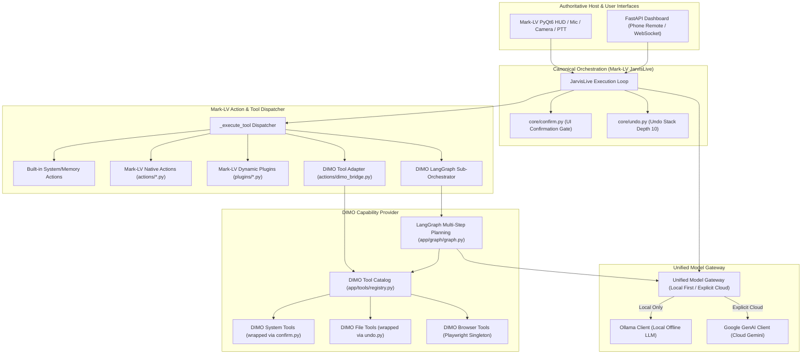

# DIMO / Mark-LV Architecture Review & Decision Gate

**Target Document:** `docs/revamp/OPUS_ARCHITECTURE_REVIEW.md`  
**Repository:** `FL4K1/DIMO`  
**Working Branch:** `revamp/marklv-parent-dimo-integration`  
**Baseline Commit:** `00051595468d6cde66c48359c56b8d81f6be221e`  
**Author:** Senior Software Architect (Review & Decision Gate)  
**Status:** Read-Only Architectural Review Complete — Ready for Review  

---

## 1. Executive Recommendation

### 1.1 Target Architecture Summary
The safest, least disruptive, and most robust architecture for consolidating this repository is **Mark-LV as Canonical Host with DIMO as an Autonomous Capability Extension**.

- **Mark-LV is the Authoritative Parent:** Mark-LV retains 100% ownership of the primary application lifecycle, the PyQt6 holographic desktop HUD, real-time voice streaming (sounddevice, wake-word detection, push-to-talk, echo cancellation), the local HTTP/WebSocket dashboard remote control, the unforgeable confirmation gate, and the reversible undo stack.
- **DIMO is the Offline AI & Complex Execution Extension:** DIMO contributes its local-first Ollama capabilities, its 26+ tool catalog (system, files, browser automation, WhatsApp), and its LangGraph stateful execution engine.
- **LangGraph as a Delegated Sub-Orchestrator:** Rather than attempting to replace Mark-LV's real-time event loop with LangGraph (which would break Gemini Live streaming, low-latency voice, and PyQt event handling), DIMO's LangGraph engine is integrated behind Mark-LV's established Action/Tool interface as a specialized multi-step reasoning worker (`deep_task` / `plan_and_execute`). Standalone, single-turn DIMO tools are adapted directly into Mark-LV's action loader without invoking a graph loop.

### 1.2 Rationale
1. **Preservation of Core User Value:** Mark-LV delivers a high-fidelity multimodal assistant with live audio, visual avatar synchronization (visemes), screen capture analysis, and remote smartphone control. These capabilities depend heavily on Mark-LV's `JarvisLive` loop and Qt threading model. Inverting this hierarchy to place LangGraph at the top level would force an immediate, high-risk rewrite of all audio, GUI, and remote streaming infrastructure.
2. **Elimination of Dual-Execution Drift:** Currently, `main.py` bootstraps Mark-LV, leaving DIMO's CLI (`main_text()` / `main_voice()`) as dead code in the root entry point. Unifying under Mark-LV's dispatch path restores a single, deterministic runtime flow while providing a clear migration bridge for DIMO's tool catalog.
3. **Strict Safety & Reversibility:** DIMO already couples to Mark-LV's safety primitives (`app/tools/native/system.py` bridges to `core.confirm`, and `app/tools/native/files.py` bridges to `core.undo`). Formalizing Mark-LV as the canonical safety authority preserves interface-held confirmation tokens and undo histories across all tool executions.

---

## 2. Current Architecture Map

### 2.1 Entry Points & Orchestration
- **Root Entry Point (`main.py`):**
  - Path: `c:\Users\Mudit Joshi\Desktop\Projects\DIMO\main.py`
  - Current Behavior: Lines 88–95 explicitly manipulate `sys.path` by prepending `app/marklv` and immediately dispatch execution to `app.marklv.main.main()`.
  - Inactive Paths: `main.py` defines `main_text()` and `main_voice()`, which construct DIMO's LangGraph via `app.graph.graph.build_graph()`. These functions are currently unreachable via the primary invocation (`python main.py`), rendering DIMO's standalone CLI inert in standard operation.
- **Mark-LV Application Entry (`app/marklv/main.py`):**
  - Current Behavior: Function `main()` initializes Qt GUI (`JarvisUI`), configures audio devices, discovers dynamic actions and plugins, starts a background daemon thread running `JarvisLive.run(loop)` under an asyncio event loop, and starts the PyQt6 event loop (`app.exec()`).
  - Orchestration Loop: `JarvisLive` establishes a bidirectional real-time connection with Gemini Live (or local LLM fallback via `core/llm_client.py`), continuously handling microphone PCM input, wake-word gating (`core/wake_word.py`), push-to-talk (`core/hotkey.py`), echo cancellation (`core/echo.py`), barge-in audio interruption, and tool execution.

### 2.2 Execution Engines
- **Mark-LV Engine (`app/marklv/main.py`):**
  - Streaming, event-driven, multimodal session loop. Tool calls arriving from the model are processed inside `JarvisLive._execute_tool(fc)` through a sequential resolution cascade:
    1. Built-in inline tools (`save_memory`, `recall_memory`, `undo`, `screen_process`, `close_camera`, `system_status`, `manage_monitor`, `shutdown_jarvis`).
    2. Dynamic action modules registered in `self._action_registry` (`core/action_loader.py`).
    3. Dynamic plugin modules registered in `self._plugin_registry` (`core/plugin_loader.py`).
- **DIMO LangGraph Engine (`app/graph/graph.py`):**
  - Turn-based, compiled state graph (`StateGraph(DimoState)`).
  - Graph Topology:
    - `START -> router` (`app/nodes/router.py`)
    - `router -> { "chat": "llm", "memory": "llm", "search": "planning", "tool": "planning" }`
    - `planning -> loop` (`app/nodes/planning.py` -> `app/nodes/loop.py`)
    - `loop -> llm` (`app/nodes/llm.py`)
    - `llm -> END`
  - Routing is governed by Ollama (default model `llama3.2:3b`) via strict single-word classification prompt.

### 2.3 Tool & Action Registries
- **Mark-LV Inline Tools (`app/marklv/main.py`):**
  - Defined in `TOOL_DECLARATIONS` list (Gemini JSON schema dictionaries). Handled directly via `if/elif` branches in `_execute_tool`.
- **Mark-LV Action Loader (`app/marklv/core/action_loader.py`):**
  - Scans `app/marklv/actions/*.py` (ignoring `_*.py`). Expects each module to expose a top-level `TOOL` dict containing `name`, `description`, `parameters`, and a callable `handler(args, ctx)`.
- **Mark-LV Plugin Loader (`app/marklv/core/plugin_loader.py`):**
  - Scans `app/marklv/plugins/*.py`. Expects each module to expose a top-level `PLUGIN` dict containing `name`, `description`, `tools`, and handler bindings.
- **DIMO Tool Catalog (`app/tools/registry.py`):**
  - Central dictionary `TOOL_CATALOG` containing 26+ native and browser-based tool definitions. Handled in DIMO's `loop.py` via programmatic parameter validation and dynamic execution.

### 2.4 Model Providers & Gateways
- **Mark-LV Providers:**
  - Gemini Live: `app/marklv/core/gemini.py` connects via `google-genai` SDK WebSocket to `gemini-2.0-flash-exp`, `gemini-2.5-flash`, or `gemini-3.1-flash-live`.
  - Local/OpenAI Fallback: `app/marklv/core/llm_client.py` (`LLMClient`) communicates with Ollama (`http://localhost:11434/api/generate`) or generic OpenAI-compatible REST endpoints.
  - Configuration: Stored in `app/marklv/config/api_keys.json` managed via `app/marklv/memory/config_manager.py`.
- **DIMO Gateway (`app/services/agents/llm_gateway.py`):**
  - `LLMGateway` switches routing dynamically: if `model_name.startswith("gemini")`, routes to Google GenAI Client; otherwise routes to local Ollama client (`OLLAMA_HOST`).

### 2.5 Memory Stores
- **Mark-LV Memory (`app/marklv/memory/memory_manager.py`):**
  - Persists to `memory.json`. Partitions facts into categories (`user_profile`, `preferences`, `facts`, `custom_instructions`, `notes`).
  - Compiles prompt context up to 200,000 characters. Supports fast keyword/index search (`search_memory`) and session summary rolling logs.
- **DIMO Memory (`app/memory/memory_manager.py`):**
  - Persists to `app/memory/long_term.json`. Strictly truncates context to 2,200 characters.
  - Background memory extraction triggered asynchronously after turns using a two-stage LLM extraction prompt (`app/memory/extractor.py`).

### 2.6 Dashboard, Remote & Safety Bridges
- **Mark-LV Dashboard (`app/marklv/dashboard/server.py`):**
  - FastAPI web server on port 8000. Authenticates via 6-character ephemeral PIN or `/auto-login?key=` QR code. Issues 32-byte session tokens. Employs AES-256-CBC client-side encryption. Supports WebSocket audio streaming from smartphones into `JarvisLive`.
- **Safety Bridges:**
  - Confirmation Gate: `app/marklv/core/confirm.py` issues unforgeable, single-use, UI-held UUID tokens for destructive actions. `app/tools/native/system.py` bridges directly into `core.confirm` for OS shutdown/restart operations.
  - Undo System: `app/marklv/core/undo.py` maintains an in-memory stack (depth 10) of reversible operations. `app/tools/native/files.py` bridges into `core.undo.push_undo` for file and directory creation.

---

## 3. Call-Flow Diagrams

### 3.1 Current System Call Flows (Dual Disjoint Paths)

```mermaid
flowchart TD
    subgraph Current_Runtime_Path ["Active Runtime Path (main.py -> Mark-LV)"]
        A["CLI: python main.py"] --> B["main.py: sys.path.insert & main()"]
        B --> C["app/marklv/main.py: main()"]
        C --> D["Qt Event Loop (JarvisUI)"]
        C --> E["Background asyncio Thread (JarvisLive)"]
        E --> F["Gemini Live WebSocket / LLMClient"]
        F --> G["_execute_tool(fc)"]
        G --> H{"Tool Dispatcher"}
        H -->|Inline Tools| I["Built-in Handlers (main.py)"]
        H -->|Action Registry| J["app/marklv/actions/*.py"]
        H -->|Plugin Registry| K["app/marklv/plugins/*.py"]
    end

    subgraph Inactive_DIMO_Path ["Divergent/Inactive Path (Unreachable from root main)"]
        L["CLI: main_text() / main_voice()"] -.-> M["app/graph/graph.py: build_graph()"]
        M -.-> N["LangGraph: router -> planning -> loop -> llm"]
        N -.-> O["app/tools/registry.py (TOOL_CATALOG)"]
        O -.-> P["app/tools/native/system.py"]
        O -.-> Q["app/tools/native/files.py"]
        P -.->|Bridge coupling| R["app/marklv/core/confirm.py"]
        Q -.->|Bridge coupling| S["app/marklv/core/undo.py"]
    end
```



### 3.2 Target Unified Call Flow (Mark-LV Host with DIMO Adapters)



---

## 4. Key Architecture Decisions

| Question | Options Considered | Chosen Direction | Rationale | Technical Risk | Reversibility |
|---|---|---|---|---|---|
| **A. Entry Point & Orchestration** | 1. Replace Mark-LV with DIMO LangGraph.<br>2. Keep dual entry points (`--ui` vs `--cli`).<br>3. **Keep Mark-LV as canonical host; adapt DIMO into Mark-LV.** | **Option 3: Mark-LV Canonical Host.** | Preserves PyQt HUD, live voice, audio tail/barge-in, and phone dashboard. LangGraph becomes a sub-orchestrator for complex tasks. | Low. Minimal changes to Mark-LV runloop; exposes DIMO via standard Mark-LV actions. | High (100% reversible via feature flag or adapter removal). |
| **B. Tool Architecture & Registry** | 1. Discard Mark-LV actions for DIMO catalog.<br>2. Discard DIMO catalog for Mark-LV actions.<br>3. **Mark-LV ActionRegistry canonical; adapt DIMO catalog via namespace.** | **Option 3: Canonical ActionRegistry with DIMO Adapter.** | Preserves dynamic action/plugin loading. Prevents collisions by prefixing DIMO tools (`dimo_*`) and mapping schemas. | Medium. Potential schema translation mismatches or missing context objects. | High (tools can be disabled individually in catalog adapter). |
| **C. Model Routing & Offline Policy** | 1. Direct model calls scattered across files.<br>2. Force all calls through Gemini Live.<br>3. **Unified Model Gateway with strict local/cloud boundaries.** | **Option 3: Unified Gateway with Explicit Offline Mode.** | Respects user privacy. Local Ollama is default for text reasoning; Gemini Live is explicit for voice/vision; cloud fallbacks fail closed when offline. | Medium. Ollama latency on low-spec hardware may stall real-time turns. | High (fallback ladder configured in `api_keys.json`). |
| **D. Memory Systems** | 1. Migrate all memory into DIMO `long_term.json`.<br>2. Overwrite DIMO with Mark-LV `memory.json`.<br>3. **Mark-LV `memory.json` authoritative; adapt DIMO extractor as background worker.** | **Option 3: Mark-LV Authoritative Store with DIMO Extractor Adapter.** | Mark-LV supports 200k char prompt-core, category management, and UI search. DIMO extraction pipeline can enrich Mark-LV categories without data loss. | High (risk of LLM extraction hallucinating or overwriting facts). | High (retain raw backups; extraction worker is opt-in). |
| **E. UI, Dashboard, Voice & Safety** | 1. Replace Mark-LV safety gates with DIMO-specific logic.<br>2. Weaken confirmation for headless execution.<br>3. **Centralize safety on Mark-LV `confirm.py` and `undo.py`.** | **Option 3: Authoritative Mark-LV Confirmation & Undo.** | Mark-LV's token-gated confirmation prevents model auto-confirmation. Undo stack protects against destructive file/setting operations. | Critical. Destructive OS actions must never bypass token verification. | High (strict decorators applied at adapter boundary). |

---

## 5. Component Disposition Table

| Subsystem / Path | Current Owner | Recommended Disposition | Operational Rationale |
|---|---|---|---|
| `main.py` (root entry) | Shared / DIMO | **KEEP AS CANONICAL** | Preserved as repository entry point, but cleaned to formally invoke Mark-LV startup without fragile inline `sys.path` tampering. |
| `app/marklv/main.py` (`JarvisLive`, `JarvisUI`) | Mark-LV | **KEEP AS CANONICAL** | Authoritative application orchestrator, event loop coordinator, and UI/voice shell. |
| `app/marklv/ui.py` | Mark-LV | **KEEP AS CANONICAL** | PyQt6 holographic interface, viseme animation, audio levels, and settings dialogs. |
| `app/marklv/core/confirm.py` | Mark-LV | **KEEP AS CANONICAL** | Authoritative safety gate. Issues unforgeable cryptographic confirmation tokens to UI/dashboard. |
| `app/marklv/core/undo.py` | Mark-LV | **KEEP AS CANONICAL** | Authoritative state-reversal stack (depth 10). |
| `app/marklv/core/action_loader.py` | Mark-LV | **KEEP AS CANONICAL** | Authoritative action discovery and invocation engine. |
| `app/marklv/core/plugin_loader.py` | Mark-LV | **KEEP AS CANONICAL** | Dynamic third-party extension loader for isolated plugin components. |
| `app/marklv/dashboard/server.py` | Mark-LV | **KEEP AS CANONICAL** | FastAPI remote control server, AES-256-CBC encryption, QR auto-login, and mobile mic streaming. |
| `app/marklv/memory/memory_manager.py` | Mark-LV | **KEEP AS CANONICAL** | Authoritative persistent memory store, prompt-core builder, and search engine. |
| `app/tools/registry.py` (`TOOL_CATALOG`) | DIMO | **INTEGRATE INTO MARK-LV** | Expose DIMO native tools to Mark-LV via a dedicated `dimo_tool_adapter` registered in Mark-LV's action loader. |
| `app/graph/graph.py` (`build_graph`) | DIMO | **INTEGRATE INTO MARK-LV** | Encapsulate as a Mark-LV action (`deep_task` / `plan_and_execute`) for multi-step chained tasks. |
| `app/services/agents/llm_gateway.py` | DIMO | **INTEGRATE INTO MARK-LV** | Refactor into the shared backend provider for `app/marklv/core/llm_client.py` to give Mark-LV unified local Ollama + Gemini routing. |
| `app/memory/extractor.py` | DIMO | **INTEGRATE INTO MARK-LV** | Adapt as an asynchronous background worker that parses session transcripts and proposes new facts to Mark-LV memory. |
| `app/tools/native/system.py` | DIMO / Bridge | **RETAIN AS COMPATIBILITY ADAPTER** | Existing bridge point importing Mark-LV `core.confirm`. Preserve and formalize under canonical adapter. |
| `app/tools/native/files.py` | DIMO / Bridge | **RETAIN AS COMPATIBILITY ADAPTER** | Existing bridge point importing Mark-LV `core.undo`. Preserve and expand undo coverage for file write/delete. |
| `app/nodes/voice.py` | DIMO | **DUPLICATE — INVESTIGATE, DO NOT DELETE** | Offline TTS/STT pipeline (faster-whisper, Piper). Untested in active runtime. Retain as optional offline voice fallback. |
| `app/marklv/core/llm_client.py` vs DIMO Gateway | Both | **DUPLICATE — INVESTIGATE, DO NOT DELETE** | Both implement Ollama REST calls. Mark-LV client supports streaming; DIMO gateway supports structured routing. Reconcile behind single interface. |
| `main.py` (`main_text`, `main_voice`) | DIMO | **POSSIBLE RETIREMENT — NOT APPROVED** | Dead CLI functions in root `main.py`. Do NOT delete; retain behind an explicit `--cli` flag for standalone testing until Phase 4. |

---

## 6. Tool Ownership & Registration Architecture

### 6.1 Tool Registration & Resolution Hierarchy
To prevent duplicate tool registration, conflicting schemas, and namespace collisions, all tool invocations must resolve through a single authoritative pipeline:

```
JarvisLive._execute_tool(name, args)
  │
  ├── 1. Built-in Inline Tools (main.py: save_memory, recall_memory, undo, screen_process, etc.)
  │
  ├── 2. Mark-LV Native Actions (actions/*.py discovered via ActionRegistry)
  │
  ├── 3. DIMO Tool Catalog Adapter (actions/dimo_bridge.py exposing namespaced dimo_* tools)
  │
  └── 4. Mark-LV Dynamic Plugins (plugins/*.py discovered via PluginRegistry)
```

### 6.2 DIMO Tool Adapter Contract
DIMO's tools are registered into Mark-LV by introducing an adapter module (`app/marklv/actions/dimo_bridge.py`). This adapter inspects `app/tools/registry.py:TOOL_CATALOG` and translates each tool into Mark-LV's expected `TOOL` declaration:
- **Namespace Isolation:** Every adapted DIMO tool is exposed to the model with a `dimo_` prefix (e.g., `dimo_browser_open`, `dimo_system_info`, `dimo_whatsapp_send`). This eliminates any possibility of collision with Mark-LV built-in actions (e.g., `web_search`, `system_status`).
- **Schema Normalization:** DIMO's parameter schemas are validated and mapped to the standard Gemini/OpenAI function declaration dictionary format (`name`, `description`, `parameters`).
- **Context Injection:** When an adapted DIMO tool executes, the adapter synthesizes the expected DIMO runtime context while passing Mark-LV's UI hooks (`speak`, `player`, `write_log`).

### 6.3 Structured Intermediate Results Passing
In multi-step workflows (whether in DIMO's LangGraph or chained Mark-LV actions), tools must never convert structured dictionaries or binary references into truncated string placeholders (e.g., passing `"[Image Captured]"` or `"{'status': 'ok'}"` as a raw string).
- **Contract Requirement:** All tool handlers must return a structured dictionary conforming to:
  ```python
  {
      "status": "success" | "error" | "pending_confirmation",
      "data": Any,           # Raw structured payload (dict, list, int, etc.)
      "summary": str,        # Human-readable sentence for voice synthesis
      "artifacts": dict      # Optional handles (e.g., file paths, image buffers, tokens)
  }
  ```
- In Mark-LV's `_execute_tool`, `response["result"]` will supply `summary` for speech synthesis while preserving the structured `data` in the execution context for downstream tools.

---

## 7. Model Routing & Local/Offline Policy

### 7.1 Unified Provider Architecture
Model interactions must be owned by a unified provider abstraction that reconciles Mark-LV's `core/llm_client.py` and DIMO's `services/agents/llm_gateway.py`.

```
                    ┌───────────────────────────────┐
                    │     Unified Model Gateway     │
                    └───────────────┬───────────────┘
                                    │
            ┌───────────────────────┴───────────────────────┐
            ▼                                               ▼
┌──────────────────────────────┐                ┌──────────────────────────────┐
│     Local-First Provider     │                │   Explicit Cloud Provider    │
│  - Ollama (localhost:11434)  │                │  - Google GenAI (Gemini)     │
│  - Zero network transmission │                │  - Gemini Live WebSocket     │
│  - Strict offline guarantee  │                │  - Requires explicit API key │
└──────────────────────────────┘                └──────────────────────────────┘
```

### 7.2 Strict Offline & Local-First Guarantees
1. **Explicit Cloud Opt-In:** Cloud access (Google Gemini) is permitted **only** if:
   - A valid `GEMINI_API_KEY` is configured in `app/marklv/config/api_keys.json`.
   - The user has selected a cloud engine in settings or explicitly issued a prompt requiring multimodal Live streaming.
2. **Fail-Closed Offline Behavior:** If network access is unavailable, DNS fails, or cloud credentials are missing, the assistant **must fail closed** for cloud tasks with an informative user error (`"Cloud service unavailable — operating in local offline mode"`). It must **never** silently redirect sensitive local data to unverified endpoints.
3. **Local Default for Agentic Chaining:** Multi-step tool loops (LangGraph) must default to local Ollama execution (`llama3.2:3b` or configured local model) unless the user explicitly requests high-parameter cloud reasoning.
4. **Credential Sanitization:** API keys, session tokens, and private keys must never be logged, printed to console, or serialized into memory exports or debug transcripts.

---

## 8. Memory Systems Coexistence & Reconciliation

### 8.1 Comparison of Current Memory Architectures

| Characteristic | Mark-LV (`app/marklv/memory/`) | DIMO (`app/memory/`) | Architectural Reconciliation |
|---|---|---|---|
| **Authoritative File** | `app/marklv/config/memory.json` | `app/memory/long_term.json` | **Retain Mark-LV store as canonical.** Keep DIMO store untouched as backup. |
| **Data Partitioning** | Structured categories (`user_profile`, `facts`, `preferences`, `custom_instructions`, `notes`) | Flat list of key-value assertions | Map DIMO assertions into Mark-LV structured categories. |
| **Context Size Limit** | 200,000 characters (supports full session recall) | 2,200 characters (aggressive truncation) | Use Mark-LV's dynamic token/character budgeting. |
| **Prompt Injection** | `format_memory_for_prompt()` formats structured core prompt context | Injected raw into LangGraph state | Feed Mark-LV's formatted prompt core into both live session and LangGraph nodes. |
| **Fact Extraction** | Explicit user action (`save_memory` tool) or session shutdown summary | Asynchronous background LLM extraction (`extractor.py`) | Restrict background extraction to a staged, non-destructive recommendation queue. |

### 8.2 Safe Handling of Hallucinated & Duplicate Facts
DIMO's background extraction uses an LLM prompt to identify facts from conversation transcripts. Unconstrained, this frequently introduces hallucinations, duplicates, or contradictory values.
- **Rule 1 (Zero Automatic Overwrite):** Extracted facts must never overwrite existing keys in `memory.json` automatically.
- **Rule 2 (Confidence & Staging Gate):** Extracted facts must be staged into a `pending_review` category or assigned a deduplication hash before committing.
- **Rule 3 (Reversibility):** An automatic backup of `memory.json` (`memory.json.bak.<timestamp>`) must be generated before any write or compaction cycle.

---

## 9. Execution State & Intermediate Results

### 9.1 Multi-Step Execution State Contract
When LangGraph or a multi-action sequence runs:
1. **Full Object Fidelity:** `DimoState` (defined in `app/graph/state.py`) maintains `messages`, `plan`, `tool_results`, and `context`. Tool results stored in `tool_results: Dict[str, Any]` must hold the complete output objects (JSON payloads, exit codes, file paths), not truncated strings.
2. **Context Passing without String Interpolation:** Downstream tools that consume outputs from preceding tools must read directly from state dictionaries using structured keys rather than having stringified approximations injected into LLM prompts.
3. **Safe Serialization:** If an intermediate result contains binary data (e.g. webcam image, screenshot), it must be preserved as a memory buffer or saved to a temporary file path with the handle passed in state, preventing LLM context window blowout.

---

## 10. UI, Dashboard, Voice & Safety Architecture

### 10.1 UI & Voice Boundary Preservation
- **PyQt6 Event Loop Integrity:** `JarvisUI` in `app/marklv/ui.py` owns the desktop display. Any background task, DIMO tool, or sub-agent must communicate with the UI exclusively through Qt Signals (`pyqtSignal`) or thread-safe callbacks (`ui.write_log`, `ui.set_state`).
- **Voice Loop Preservation:** `JarvisLive` in `app/marklv/main.py` retains exclusive ownership of the microphone (`sounddevice.InputStream`), audio queue (`audio_in_queue`), push-to-talk (`PushToTalk`), and audio echo tail management (`EchoGuard`). Neither DIMO nor any sub-agent may open hardware audio streams directly while Mark-LV is running.

### 10.2 Safety Gates: Confirmation & Undo
- **Unforgeable Confirmation Gate (`core/confirm.py`):**
  - High-impact operations (system shutdown/restart, volume/display alterations beyond thresholds, broad file deletions, external messaging) must request confirmation via `core.confirm.request()`.
  - The confirmation token is a randomly generated UUID stored exclusively in UI memory and displayed on the HUD/Dashboard banner.
  - The model **cannot** approve its own actions; the execution handler halts until the user physically clicks the confirmation banner or delivers the valid token via dashboard.
- **Shared Undo Stack (`core/undo.py`):**
  - File operations and configuration adjustments must push a reversible zero-argument callable to `push_undo(label, undo_fn)`.
  - Stack depth is capped at 10 items.
  - Calling `undo` reverses the most recent operation and reports the outcome to the user.

### 10.3 Dashboard & Remote Access Security Review
- **Authentication:** `app/marklv/dashboard/server.py` implements a 6-character one-time PIN and QR code auto-login generating a 32-byte session token (`secrets.token_urlsafe(32)`).
- **Transport Security:** Application-layer AES-256-CBC encryption is derived from the session key (`_derive_key`).
- **Firewall Integration:** `_ensure_network_access` configures OS firewall rules for LAN port access.
- **Security Audit Note:** The repository contains tracked certificate files (`app/marklv/config/certs/jarvis.key`, `jarvis.crt`). Because generating certificates locally per installation is already implemented in `_ensure_certs()`, the presence of tracked repository keys represents an operational risk. **Recommendation:** Maintain existing files during review; schedule rotation and git-untracking for a future security slice.

---

## 11. Staged Migration Plan


### Phase 0: Behavioral Characterization & Safe Test Harness
- **Objective:** Establish isolated test harnesses without modifying application code.
- **Prerequisites:** Clean working tree on `revamp/marklv-parent-dimo-integration`.
- **Tasks:**
  - Create disposable mock test configurations for `api_keys.json` and memory stores.
  - Implement read-only schema linter verifying all tool declarations in both Mark-LV and DIMO.
- **Validation Requirement:** All checks execute in isolation without starting GUI, opening audio devices, or initiating external network calls.
- **Rollback Procedure:** Discard test harness files.
- **Stop Condition:** Any failure in importing core modules in isolation.

### Phase 1: Narrow Adapter Proof-of-Concept (First Implementation Slice)
- **Objective:** Create a single Mark-LV Action adapter that exposes one inert, read-only DIMO tool to Mark-LV.
- **Prerequisites:** Phase 0 complete.
- **Tasks:**
  - Create `app/marklv/actions/dimo_bridge.py` exposing a single safe read-only tool (`dimo_system_info`).
  - Verify discovery by `app/marklv/core/action_loader.py`.
- **Validation Requirement:** Mark-LV discovers the tool and dispatches to it without error; existing Mark-LV actions remain unaffected.
- **Rollback Procedure:** Delete `app/marklv/actions/dimo_bridge.py`.
- **Stop Condition:** Action loader collision or failure to register tool declaration.

### Phase 2: Bounded DIMO Tool Catalog Ingestion
- **Objective:** Incrementally adapt DIMO tools in logical, risk-stratified groups.
- **Prerequisites:** Phase 1 validated.
- **Groups:**
  1. *Group A (Read-Only System/Info):* System info, battery, disk usage.
  2. *Group B (Files with Undo):* File reading, searching, writing (enforcing `core.undo.push_undo`).
  3. *Group C (Browser Automation):* Playwright browser controller (isolated profile).
  4. *Group D (High-Impact System/External):* Shutdown, restart, messaging (enforcing `core.confirm.request`).
- **Validation Requirement:** Each group passes unit schema tests and undo/confirmation assertions.
- **Rollback Procedure:** Revert specific tool group mappings in `dimo_bridge.py`.
- **Stop Condition:** Any high-impact tool executing without triggering confirmation gate.

### Phase 3: Unified Model Gateway & Offline Policy Enforcement
- **Objective:** Unify Ollama and Gemini dispatch behind a common provider interface.
- **Prerequisites:** Phase 2 complete.
- **Tasks:**
  - Adapt `app/services/agents/llm_gateway.py` to power `app/marklv/core/llm_client.py`.
  - Add explicit `offline_mode` setting in `api_keys.json` that fails closed against cloud endpoints.
- **Validation Requirement:** When offline or with invalid cloud keys, all local Ollama requests succeed and cloud requests report graceful offline status without throwing unhandled exceptions.
- **Rollback Procedure:** Restore original `core/llm_client.py`.
- **Stop Condition:** Local data sent over network when offline mode is enabled.

### Phase 4: Memory System Bridging & LangGraph Sub-Orchestration
- **Objective:** Expose LangGraph as a delegated multi-step action and connect DIMO memory extraction.
- **Prerequisites:** Phase 3 complete.
- **Tasks:**
  - Expose DIMO's compiled graph as `actions/deep_task.py`.
  - Bridge DIMO background extraction to propose categorized memory updates to Mark-LV `memory.json`.
- **Validation Requirement:** Deep task successfully chains 2+ tools and returns structured summary to Mark-LV; memory extraction does not overwrite existing profile facts.
- **Rollback Procedure:** Disable `deep_task` action and background extractor thread.
- **Stop Condition:** Memory corruption or infinite planning loop in LangGraph.

---

## 12. First Implementation Slice

### 12.1 Specification for Next Agent (Antigravity Flash)
- **Title:** Narrow DIMO Read-Only System Info Action Adapter
- **Risk Level:** Exceptionally Low (Additive, read-only, no side effects).
- **Exact Scope:**
  1. Create a new file: `app/marklv/actions/dimo_system_info.py`.
  2. Implement Mark-LV action contract:
     - Expose `TOOL` dictionary with `name="dimo_system_info"`, comprehensive description, and empty parameters schema.
     - Implement `handler(args, ctx)` that imports `get_system_info` from `app.tools.native.system` and returns a formatted system summary string.
  3. Do **not** touch `app/marklv/main.py`, `app/tools/registry.py`, or any core engine.
- **Success Criteria:**
  1. `ActionRegistry.discover_actions()` discovers `dimo_system_info` alongside existing Mark-LV actions.
  2. `ActionRegistry.has("dimo_system_info")` evaluates to `True`.
  3. `ActionRegistry.run("dimo_system_info", {}, {})` executes successfully in an isolated test script and returns system metrics.
  4. Zero changes to existing Mark-LV actions, UI, voice, or DIMO tools.

---

## 13. Validation Plan

### 13.1 Pre-Change Validation Checklist
Before modifying any files in Phase 1:
- [ ] Confirm clean git status on `revamp/marklv-parent-dimo-integration`.
- [ ] Verify `app/marklv/actions/` contains existing expected actions (`app_control.py`, `browser.py`, `media_player.py`, etc.).
- [ ] Ensure test environment has `app` and `app/marklv` resolvable on `PYTHONPATH`.

### 13.2 Post-Change Validation Checklist
After implementing the first slice:
- [ ] Run an isolated, read-only script importing `ActionRegistry` from `app.marklv.core.action_loader`.
- [ ] Assert `ActionRegistry.get_tool_declarations()` includes `dimo_system_info`.
- [ ] Verify that no other tool declaration has been altered, renamed, or dropped.
- [ ] Confirm git diff contains **only** the newly added adapter file.

---

## 14. Open Questions & Required Evidence

1. **Tracked Certificate Hygiene:**
   - *Issue:* `app/marklv/config/certs/jarvis.key` and `jarvis.crt` are tracked in git history.
   - *Evidence Required:* Owner confirmation whether these are test dummy certs or live credentials, and approval to remove them from tracking in favor of the auto-generation logic in `_ensure_certs()`.
2. **Audio Stack Hardware Portability:**
   - *Issue:* Mark-LV relies on `sounddevice` with Windows-specific defaults and WASAPI device handling.
   - *Evidence Required:* Verification of audio device enumeration on non-Windows test environments (Linux/macOS) if cross-platform support is intended.
3. **DIMO Playwright Browser Singleton Concurrency:**
   - *Issue:* `BrowserManager` in `app/browser/browser_manager.py` maintains global browser state.
   - *Evidence Required:* Concurrency testing to verify whether simultaneous requests from Mark-LV HUD and background actions cause browser context collisions.
4. **WhatsApp Session Persistence:**
   - *Issue:* DIMO's WhatsApp tool relies on stored browser session profile data.
   - *Evidence Required:* Investigation into where session cookies/profiles are stored and whether pathing works cleanly when invoked from Mark-LV's working directory.

---

## 15. Acceptance Checklist

- [x] Mark-LV confirmed as canonical application and UI owner.
- [x] DIMO positioned as capability extension, not top-level replacement.
- [x] Clear resolution for all 5 core questions (A, B, C, D, E).
- [x] Complete Component Disposition Table covering all major modules.
- [x] Tool collision prevention and structured result passing specified.
- [x] Strict local/offline model policy defined.
- [x] Memory systems coexistence and safety rules established.
- [x] UI, voice, confirmation gate, and undo protections fully preserved.
- [x] Staged 4-phase migration plan with explicit stop conditions.
- [x] Narrow, low-risk first implementation slice detailed for Antigravity Flash.
- [x] Zero production source files modified during this review.
